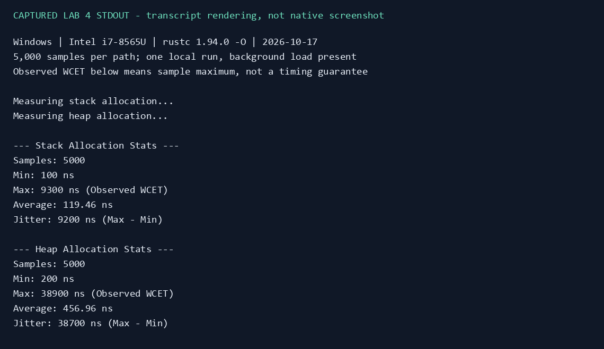
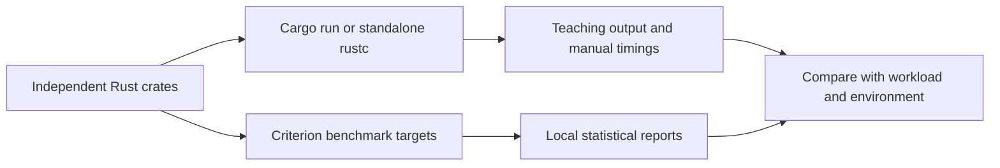

# Real-Time Analysis Labs in Rust

Independent coursework exercises exploring Rust basics, scheduling drift, mutex sharing, allocation cost, error handling, dispatch and data layout. This repository is a collection of teaching experiments, with each Cargo package run separately; it is not a production real-time framework or a top-level Cargo workspace.

**Status:** some examples run, while the language-tour crate has a syntax error, the mutex example can deadlock, and Lab 4's Cargo manifest references a missing benchmark. These blockers are preserved and recorded rather than hidden. The [verification record](docs/VERIFICATION.md) distinguishes successful runs, expected failures and benchmark smoke checks.



*Rendering of captured Lab 4 stdout from a locally compiled source run on 17 October 2026, not a native terminal screenshot. These are single-machine teaching measurements, not a worst-case timing guarantee. [Full captured checks](docs/assets/verification-transcript.txt).*

## Exercises and current scope

| Package / path | Experiment | Important boundary |
|---|---|---|
| `lab-1/testProject` | Ferris greeting and Rust language tour | Extra closing brace prevents compilation. |
| `Lab-2` | Basic Cargo hello-world crate | Prints one greeting. |
| `Lab-2/lab2_jitter` | 100 nominal 10 ms sleeps while four busy threads run | Reports accumulated schedule drift with an extra subtraction; not independent wake-up jitter. |
| `Lab-2/lab2_safety` | `Arc<Mutex<Vec<i32>>>` shared with a worker | Main retains its lock during `join`; bounded run reproduces a hang. |
| `lab-4/lab4_metrics` | 5,000 stack and heap timing samples | Standalone source runs; Cargo manifest references absent `my_benchmark`. Stack is zero-filled; heap reserves capacity without initialization. |
| `lab5_costs` | `Ok`, `Err`, caught panic; generic vs trait-object dispatch | Panic hook prints messages even when the panic is caught. |
| `lab5_efficiency` | Loop vs iterator; array-of-structs vs struct-of-arrays | Random million-element inputs, without a fixed seed. |



## Run locally

Requires Rust 1.85 or newer for edition 2024; verification used Rust/Cargo 1.94.0 on Windows. Python 3.10+ is optional for the bounded verification helper. Dependencies are declared separately in each package.

```powershell
cargo run --locked --manifest-path Lab-2/Cargo.toml
cargo run --release --locked --manifest-path Lab-2/lab2_jitter/Cargo.toml
```

Lab 4's source only uses the standard library and can be explored independently of its broken Cargo benchmark declaration:

```powershell
rustc --edition=2024 -O lab-4/lab4_metrics/src/main.rs -o "$env:TEMP/lab4_metrics.exe"
& "$env:TEMP/lab4_metrics.exe"
```

The verification helper rebuilds from source into temporary or ignored external build directories, limits hangs, and records expected failures:

```powershell
python -B scripts/verify.py
```

For full statistical runs, use the individual benchmark targets. These commands may take several minutes and produce hardware-dependent results:

```powershell
cargo bench --locked --manifest-path lab5_costs/Cargo.toml --bench cost_benchmark
cargo bench --locked --manifest-path lab5_efficiency/Cargo.toml --bench efficiency_bench
```

Fresh smoke checks use Criterion's `--test` mode; they exercise benchmark functions without producing a new statistical comparison. [Saved historical results](docs/PROJECT_GUIDE.md#results) are preserved from the previous guide and have unknown machine context. They should not be treated as measurements from this verification.

## Context and deeper material

The code and `Notes.txt` identify this as Real-Time Analysis lab work. Personal contribution or grading outcomes are not established by the source. There is no Lab 3 in the snapshot and no automated correctness test suite.

The [full project guide](docs/PROJECT_GUIDE.md) preserves the source walkthroughs, workload caveats, historical results and troubleshooting. Generated `target/` files and local editor permissions are now ignored and removed from the current tracked snapshot, with local files retained; older Git history is unchanged. No standalone license file is present.
