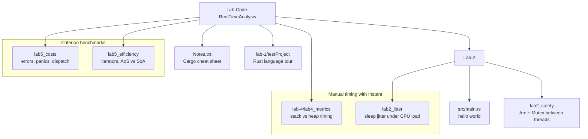
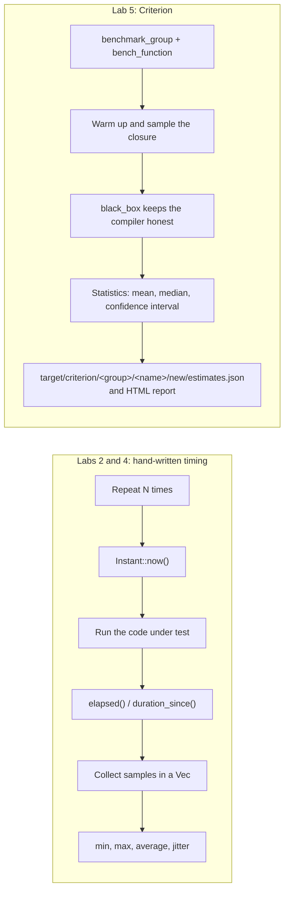
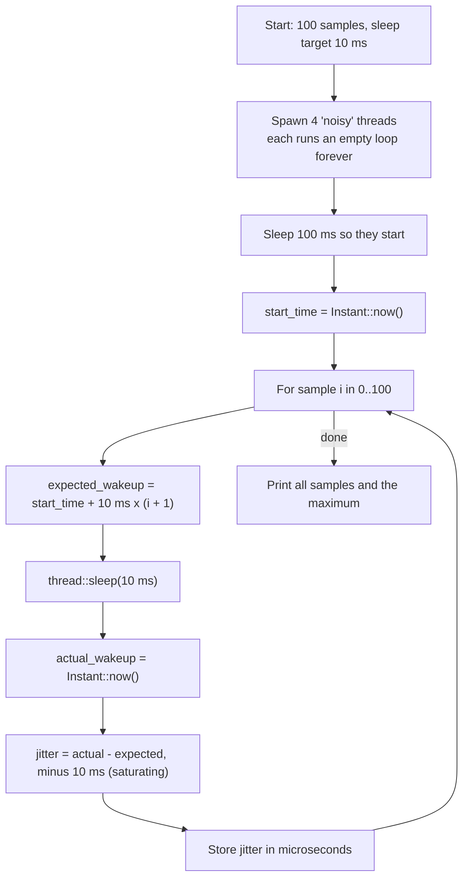
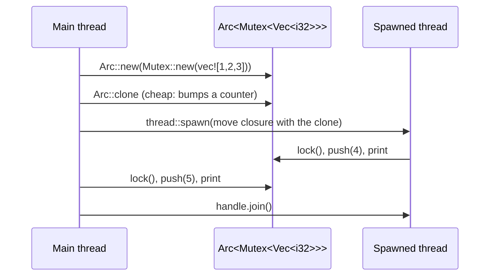
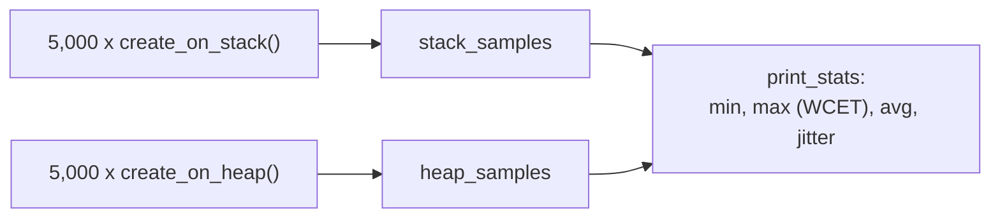
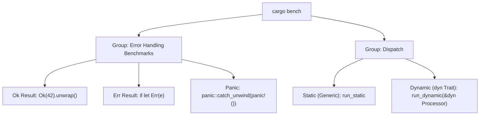
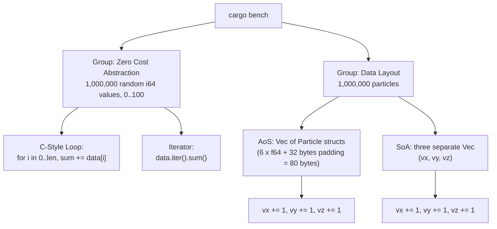

# Real-Time Analysis Lab Code (Rust)

A collection of small **Rust lab projects** for a Real-Time Analysis module. Each lab is a separate Cargo project that explores one question about how predictable and how fast code is: language basics, **timing jitter**, **thread safety with a mutex**, **stack vs heap allocation cost**, the **cost of error handling and dynamic dispatch**, and the **efficiency of iterators and data layout**. The later labs use **Criterion** to benchmark. Numbers transcribed from the previously tracked reports are retained here as historical evidence; current execution checks are in [VERIFICATION.md](VERIFICATION.md).

---

## Table of contents

1. [What it does](#what-it-does)
2. [Repository map](#repository-map)
3. [Project structure](#project-structure)
4. [Setup and run](#setup-and-run)
5. [Lab 1: Rust basics (`lab-1/testProject`)](#lab-1-rust-basics)
6. [Lab 2: Jitter and thread safety (`Lab-2`)](#lab-2-jitter-and-thread-safety)
7. [Lab 4: Stack vs heap metrics (`lab-4/lab4_metrics`)](#lab-4-stack-vs-heap-metrics)
8. [Lab 5: Costs (`lab5_costs`)](#lab-5-costs)
9. [Lab 5: Efficiency (`lab5_efficiency`)](#lab-5-efficiency)
10. [Results](#results)
11. [Code walkthrough](#code-walkthrough)
12. [Troubleshooting](#troubleshooting)
13. [Limitations and next steps](#limitations-and-next-steps)
14. [Repository hygiene notes](#repository-hygiene-notes)

---

## What it does

- Teaches Rust step by step: the first lab is a tour of the language, the later labs are measurement experiments for real-time concerns (latency, jitter, worst-case time).
- Measures timing in two ways: **hand-rolled timing** with `std::time::Instant` (Lab 2 jitter, Lab 4 metrics) and **statistical benchmarking** with the Criterion crate (Lab 5, plus the original Lab 4 benchmark).
- Keeps every lab as its own Cargo package, so each one builds and runs on its own. There is no top-level Cargo workspace.

| Technology | Role |
|---|---|
| Rust (edition 2024) | Language for every lab; needs Rust 1.85 or newer. The committed build metadata was produced with rustc 1.93.0 and 1.94.0 on `x86_64-pc-windows-msvc` |
| Cargo | Build, run and bench tool |
| `std::thread`, `Arc`, `Mutex` | Threads and shared state in Lab 2 |
| `std::time::Instant` | Manual timing in Labs 2 and 4 |
| [`criterion`](https://crates.io/crates/criterion) | Statistical benchmarks (0.7 in `lab-4` and `lab5_costs`, 0.5 in `lab5_efficiency`) |
| [`rand`](https://crates.io/crates/rand) | Random test data (0.8 in `lab5_efficiency`; 0.9.2 declared in `lab-4` but not used by its `main.rs`) |
| [`ferris-says`](https://crates.io/crates/ferris-says) | ASCII-art crab greeting in Lab 1 |

---

## Repository map



There is no Lab 3 in the repository: the folders go from Lab 2 straight to Lab 4.

---

## Project structure

Source files only. Previously tracked `target/` output is now ignored and untracked; local files and older Git history are preserved.

```
Lab-Code-RealTimeAnalysis/
├── Notes.txt                       # How to make a Cargo project and add a dependency
├── .claude/settings.local.json     # Local Claude Code permission settings (see hygiene notes)
│
├── lab-1/
│   └── testProject/
│       ├── Cargo.toml              # depends on ferris-says 0.3.2
│       └── src/main.rs             # Tour of Rust: types, control flow, ownership, structs, enums
│
├── Lab-2/                          # Package "Lab-2" (hello world) with two nested packages
│   ├── Cargo.toml
│   ├── src/main.rs                 # "Hello, world!"
│   ├── lab2_jitter/
│   │   ├── Cargo.toml
│   │   └── src/main.rs             # Measures thread::sleep jitter with 4 busy threads
│   └── lab2_safety/
│       ├── Cargo.toml              # package name is "lab1_safety"
│       └── src/main.rs             # Shared Vec behind Arc<Mutex<..>>
│
├── lab-4/
│   └── lab4_metrics/
│       ├── Cargo.toml              # declares a [[bench]] "my_benchmark" (file no longer present)
│       └── src/main.rs             # Stack vs heap allocation, 5,000 samples each
│
├── lab5_costs/
│   ├── Cargo.toml                  # criterion 0.7
│   ├── src/main.rs                 # "Hello, world!"
│   └── benches/cost_benchmark.rs   # Ok vs Err vs panic; static vs dynamic dispatch
│
└── lab5_efficiency/
    ├── Cargo.toml                  # rand 0.8, criterion 0.5
    ├── src/main.rs                 # "Hello, world!"
    └── benches/efficiency_bench.rs # Loop vs iterator; AoS vs SoA
```

---

## Setup and run

### 1. Prerequisites

- A Rust toolchain with Rust 1.85 or newer (edition 2024), installed with [rustup](https://rustup.rs).
- Internet access the first time, so Cargo can download `ferris-says`, `rand` and `criterion`.

### 2. Run a lab

Each lab is its own Cargo project, so change into its folder first and run Cargo there. Do not run the commands from the repository root; there is no root `Cargo.toml`.

```bash
# Lab 1: language tour
cd lab-1/testProject
cargo run

# Lab 2: jitter (use --release for realistic timing; stop with Ctrl+C if it does not exit)
cd Lab-2/lab2_jitter
cargo run --release

# Lab 2: mutex example
cd Lab-2/lab2_safety
cargo run

# Lab 5: Criterion benchmarks (HTML reports go to target/criterion/report/index.html)
cd lab5_costs
cargo bench

cd lab5_efficiency
cargo bench
```

Lab 4 needs a small fix before it builds; see [Lab 4](#lab-4-stack-vs-heap-metrics).

### 3. The author's own notes (`Notes.txt`)

```text
Making Cargo Project:
-cd (change directory)
-in terminal write  "cargo new lab_project"
-Later write  "cargo run" in terminal

Adding Dependencies:
-in terminal write "cargo add ferris-says"
- then type "cargo build"
```

### 4. How the benchmarking labs work



---

## Lab 1: Rust basics

`lab-1/testProject/src/main.rs` is a single `main` that prints the output of each Rust concept in turn. It starts with the `ferris-says` crab (`say("Hello from Ferris!", ...)`) and then walks through:

| Topic | Examples in the file |
|---|---|
| Variables and types | `let mut x`, `i32`, `u64`, `f64`, `char`, `bool`, `&str`, a `const` |
| Operators | arithmetic, assignment (`+=`, `%=`), comparison, logical |
| Control flow | `if / else if`, `if` as an expression, `match` on a day number, `loop` with a break value, `while` with `continue`, `for` over a range with `continue` and `break` |
| Functions and scope | a nested `fn add`, block shadowing |
| Strings | `to_string()`, `String::from` |
| Ownership | move, `clone()`, borrowing (`&a`), mutable reference (`&mut name`) |
| Collections | array, `Vec`, tuple, `HashMap` |
| User types | a `struct Person`, an `enum Direction` matched with `match` |

Status of the committed source: reading the file, line 188 holds a closing `}` that ends `main` right after the "Clone" section, so the statements from "Borrowing and References" (line 191) onward sit outside any function. As written, that looks like a compile error; deleting that one brace should fix it. This comes from reading the file; the code was not built for this README.

---

## Lab 2: Jitter and thread safety

`Lab-2/` is a package whose own `src/main.rs` only prints "Hello, world!". The real work is in two nested packages with their own `Cargo.toml`:

### `lab2_jitter`: how late does `thread::sleep` wake up?



The four spinning threads create CPU load so the scheduler has competing work and the sleeping thread may be woken late. The program prints every sample (in microseconds) and the maximum, in microseconds and milliseconds. The spinning threads are never joined; they end when `main` returns.

### `lab2_safety`: sharing a `Vec` between two threads



The code comments explain each step: wrap the data in a `Mutex`, then an `Arc`; clone the `Arc` for the new thread; lock before use; the lock is released when the guard goes out of scope.

Reading the code, there is a possible deadlock: the main thread keeps its `MutexGuard` (it shadows the name `data`) alive until the end of `main`, but calls `handle.join()` while still holding it. If the main thread takes the lock first, the spawned thread blocks on `lock()` and `join()` never returns. Dropping the guard (`drop(data)` or an inner `{ ... }` block) before `join()` avoids this. (Found by reading the code; whether it hangs depends on which thread locks first.)

The package name inside `lab2_safety/Cargo.toml` is `lab1_safety` (the folder is `lab2_safety`), so the binary is called `lab1_safety`.

---

## Lab 4: Stack vs heap metrics

`lab-4/lab4_metrics/src/main.rs` times creating a 1,024-byte buffer two ways, 5,000 times each, with `Instant`:

| Function | What it does |
|---|---|
| `create_on_stack` | `[0u8; 1024]` array on the stack |
| `create_on_heap` | `Vec::<u8>::with_capacity(1024)` on the heap |

Both results go through `black_box` so the compiler cannot remove them. `print_stats` prints sample count, **min**, **max** (labelled "Observed WCET", worst-case execution time), **average**, and **jitter** (`max - min`) in nanoseconds.



**Known build problem.** `Cargo.toml` still declares

```toml
[[bench]]
name = "my_benchmark"
harness = false
```

but `benches/my_benchmark.rs` was deleted in commit `4257558`. Cargo refuses to load a manifest whose bench target has no file, so `cargo run` fails until you either create `benches/my_benchmark.rs` or remove that `[[bench]]` block. The deleted Criterion benchmark (group "Stack vs Heap" with `Stack`, `Heap` and `Push to Vec`) can be restored from git history: `git show 794c82a:lab-4/lab4_metrics/benches/my_benchmark.rs`. Its results are still in `target/criterion/` (see [Results](#results)). `rand` is declared as a dependency but not used by `main.rs`.

---

## Lab 5: Costs

`lab5_costs/benches/cost_benchmark.rs` is a Criterion benchmark asking: **what do error handling and dynamic dispatch cost?** (`src/main.rs` is only "Hello, world!".)



- **Error handling:** compares a function returning `Ok(42)`, one returning `Err("...")`, and one that panics and is caught with `catch_unwind`.
- **Dispatch:** a `Processor` trait with an `Adder` implementation (`val + 1`) is called through a generic function (static dispatch, resolved at compile time) and through `&dyn Processor` (dynamic dispatch through a vtable). Inputs and outputs are wrapped in `black_box`.

---

## Lab 5: Efficiency

`lab5_efficiency/benches/efficiency_bench.rs` is a Criterion benchmark with two questions. (`src/main.rs` is only "Hello, world!".)



- **Zero-cost abstraction:** do iterators cost more than an indexed loop for summing a million numbers?
- **Data-oriented design:** the same update is applied to an **array of structs** (each `Particle` carries position, velocity and a 32-byte `pad`, so each update touches memory spread across 80-byte records) and to a **struct of arrays** (only the three velocity arrays are read and written).

---

## Results

These numbers are not from a fresh run. They are read from the `new/estimates.json` files that Criterion left in each lab's `target/criterion/` folder and that are committed in the repository (mean with its 95 percent confidence interval from the file). The hardware is not recorded in the repository; the build metadata shows Windows x86_64 (MSVC). Treat them as one machine, one run.

### Lab 4: allocation (original Criterion benchmark)

| Benchmark | Mean (ns) | 95% CI (ns) |
|---|---|---|
| Stack (1,024-byte array) | 23.96 | 22.97 to 24.98 |
| Heap (`Vec::with_capacity(1024)`) | 102.94 | 97.69 to 108.19 |
| Push to Vec | 126.89 | 121.29 to 132.41 |

The heap case was about 4.3 times slower than the stack case.

### Lab 5 costs

| Benchmark | Mean | 95% CI |
|---|---|---|
| Ok Result | 0.778 ns | 0.738 to 0.818 ns |
| Err Result | 1.275 ns | 1.221 to 1.331 ns |
| Panic (caught) | 481,037 ns (about 481 microseconds) | 460,943 to 507,724 ns |
| Static (generic) dispatch | 1.738 ns | 1.657 to 1.820 ns |
| Dynamic (`dyn Trait`) dispatch | 3.081 ns | 2.950 to 3.214 ns |

Returning an error cost roughly the same order as returning `Ok`, while a caught panic cost about five orders of magnitude more, which is why panics do not belong on a real-time path. Dynamic dispatch was about 1.8 times the static call in this run. Values below 1 to 2 ns mean the compiler has reduced the call to almost nothing, so read the ratio, not the absolute figure.

### Lab 5 efficiency

| Benchmark | Mean | 95% CI |
|---|---|---|
| C-style loop | 885 microseconds | 812 to 965 microseconds |
| Iterator (`iter().sum()`) | 1,120 microseconds | 1,024 to 1,227 microseconds |
| AoS update (1M particles) | 12.0 ms | 11.6 to 12.4 ms |
| SoA update (1M particles) | 3.36 ms | 3.25 to 3.48 ms |

The structure-of-arrays layout was about 3.6 times faster than the array-of-structs layout. In this particular run the iterator was **not** faster than the loop (it measured about 27 percent slower), so the committed data does not demonstrate "zero cost" for this sum; with the spread seen here (the medians are 772 and 967 microseconds) it is best treated as inconclusive and worth re-running on a quiet machine.

### Lab 2 jitter and Lab 4 `main.rs`

No output from these two programs is stored in the repository, so no figures are quoted. Run them to get your own samples.

---

## Code walkthrough

### Jitter calculation (`lab2_jitter`)

```rust
let expected_wakeup: Instant = start_time + SLEEP_DURATION * (i + 1);
thread::sleep(SLEEP_DURATION);
let actual_wakeup: Instant = Instant::now();
let jitter: Duration = actual_wakeup
    .duration_since(expected_wakeup)
    .saturating_sub(SLEEP_DURATION);
jitter_sample.push(jitter.as_micros());
```

`expected_wakeup` is an absolute schedule (10 ms, 20 ms, 30 ms, ...). Because each sleep starts after the previous one ended, lateness accumulates from sample to sample. Then the code subtracts one `SLEEP_DURATION` from the difference, so a sample is only non-zero once the accumulated lateness exceeds 10 ms; smaller lateness is reported as 0. If the goal is the lateness of each individual wake-up, compare `actual_wakeup` with the previous wake-up time plus 10 ms and do not subtract `SLEEP_DURATION` again.

### Black-boxed allocation (`lab4_metrics`)

```rust
fn create_on_stack() {
    let buffer: [u8; BUFFER_SIZE] = [0; BUFFER_SIZE];
    black_box(buffer);            // stop the optimiser from deleting the work
}

fn create_on_heap() {
    let buffer: Vec<u8> = Vec::with_capacity(BUFFER_SIZE);
    black_box(buffer);
}
```

The stack version zero-fills 1,024 bytes; the heap version asks the allocator for 1,024 bytes without writing to them. The two functions therefore do different work as well as using different memory, which is worth remembering when comparing the numbers.

### Static vs dynamic dispatch (`lab5_costs`)

```rust
fn run_static<T: Processor>(processor: &T, val: u32) -> u32 { processor.process(val) }
fn run_dynamic(proc: &dyn Processor, val: u32) -> u32 { proc.process(val) }
```

The generic version is compiled separately for each concrete type and can be inlined. The `&dyn Processor` version calls through a vtable, so the compiler usually cannot inline it.

### Array of structs vs struct of arrays (`lab5_efficiency`)

```rust
fn process_aos(particles: &mut [Particle]) {
    for p in particles { p.vx += 1.0; p.vy += 1.0; p.vz += 1.0; }
}
fn process_soa(particles: &mut Particles) {
    for i in 0..particles.vx.len() {
        particles.vx[i] += 1.0; particles.vy[i] += 1.0; particles.vz[i] += 1.0;
    }
}
```

Both do the same arithmetic. The AoS loop strides through 80-byte records and loads position and padding it never uses; the SoA loop reads three tightly packed arrays.

---

## Troubleshooting

| Problem | What to check |
|---|---|
| `could not find Cargo.toml` | Each lab is its own project. `cd` into the lab folder (for example `lab5_costs`) before running Cargo |
| `can't find 'my_benchmark' bench at 'benches/my_benchmark.rs'` in Lab 4 | The bench file was deleted. Remove the `[[bench]]` section from `lab-4/lab4_metrics/Cargo.toml` or restore the file from commit `794c82a` |
| Compile error in `lab-1/testProject` near line 191 | An extra `}` on line 188 closes `main` too early; remove it |
| `edition2024` is not stable / unknown edition | Update Rust: `rustup update` (Rust 1.85 or newer) |
| `lab2_safety` hangs | Likely the mutex deadlock described in [Lab 2](#lab-2-jitter-and-thread-safety); press Ctrl+C |
| `lab2_jitter` pegs all CPU cores for a moment | Expected: it starts four infinite busy loops on purpose. It ends when `main` finishes |
| Panic messages flood the terminal during `cargo bench` in `lab5_costs` | The "Panic" benchmark panics on every iteration and the default panic hook prints each one. Redirect stderr or install a quiet panic hook if it bothers you |
| Benchmark numbers differ from the Results section | Expected. Timing depends on CPU, power plan and background load. Use `cargo bench` on an idle machine and compare ratios |

---

## Limitations and next steps

- **No top-level workspace or tests.** There is no root `Cargo.toml`, no CI and no tests; each lab is checked only by running it.
- **Lab 3 is missing**, and Lab 4's manifest is broken (see above).
- **Lab 1 does not compile as committed** (extra closing brace, line 188), and it has compiler warnings such as an unused first assignment to `x` and the non-snake-case variable `capitalCities`.
- **`lab2_safety` may deadlock** and its package name (`lab1_safety`) does not match its folder.
- **The jitter metric under-reports** small delays and accumulates drift (see the walkthrough).
- **Stack vs heap comparison is not like for like**: one zero-fills, the other only reserves capacity.
- **Single-machine measurements.** The committed numbers come from one unknown Windows machine and one run, and the iterator-versus-loop result is inconclusive.
- **Ideas for next steps:** add a workspace `Cargo.toml` so `cargo bench` can run everything; fix Lab 1 and Lab 4; compute percentiles (p99, p99.9) in the manual timing labs instead of only min, max and average; use a real-time clock source (`clock_nanosleep` with absolute deadlines) and thread priorities for a better jitter experiment; write each lab's takeaways in its own short README.

---

## Repository hygiene notes

The portfolio update untracked generated `target/` contents and `.claude/settings.local.json`, preserving local files and Git history. `.gitignore` now covers build directories, binaries, symbols and local editor permissions. Historical benchmark figures transcribed above remain useful as recorded observations, but the original build reports are no longer part of the current tracked snapshot. Cargo lockfiles remain committed. No standalone license file is present.
